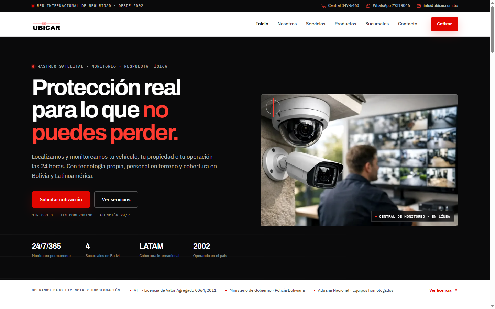

# UBICAR ® — Corporate Security Website

Six-page corporate site for a Bolivian security company operating since 2002: satellite tracking, fleet logistics, property monitoring and physical response.



## What it is

A complete corporate site: home, about, services, products, branches and contact. Shared header and footer, a 21-part product catalogue and a branch directory linked to Google Maps.

It is a static site, not an application. There is no backend, CMS or database: content lives in the HTML, and the contact form validates in the browser and hands the conversation to WhatsApp.

## Why this over a page builder

- **Clean, dependency-free build.** Hand-written HTML, CSS and JavaScript. No framework, no build step, no UI library, no icon font.
- **One visual system.** Black, red and white; Archivo for headings, IBM Plex Sans for text and IBM Plex Mono for technical labels. Six pages share the same spacing, grid and section rhythm.
- **Accessible by default (WCAG 2.1 AA).** Skip link, semantic landmarks, visible focus, a mobile menu with a focus trap and scroll lock, and `prefers-reduced-motion` support.
- **Performance-conscious media.** WebP images with 1x/2x variants and responsive `srcset`; inline SVG icons.
- **Honest forms.** Validation runs in the browser, then opens WhatsApp with a prefilled message. If the popup is blocked, the page offers a direct link and an email fallback — no fake "request sent" state.

## Quick start

Open `index.html` directly, or serve the folder:

```bash
python -m http.server 8080
```

Visit <http://localhost:8080>.

## Project structure

```text
index.html              # Home
styles.css              # Shared visual system
main.js                 # Navigation, reveal and form handling
routes/                 # about, services, products, branches, contact
img/                    # Optimized WebP images
docs/screenshot.webp    # README screenshot
```

## Status and scope

The site is live at <https://jordanroberto74.github.io/ubicar/>. Contact details, service descriptions and the product catalogue are illustrative for this public demo. Content changes are made in the HTML; there is no admin panel. The repository is public for portfolio review, but the work is proprietary — see the license.

## License

Proprietary, all rights reserved. See [LICENSE](LICENSE). The UBICAR ® name, logo and brand assets belong to their respective owner.
